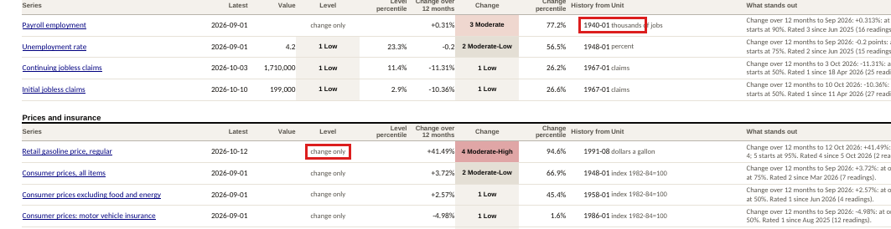
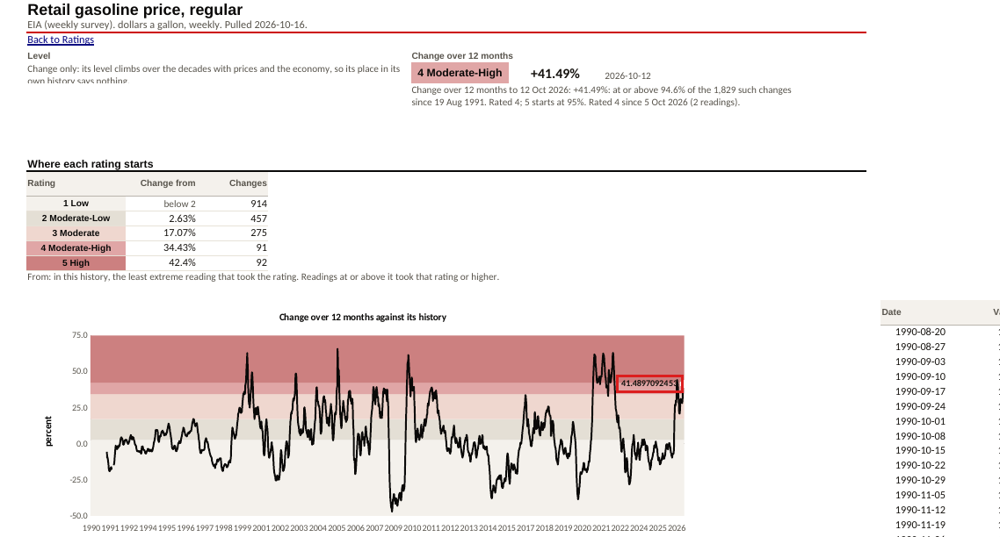
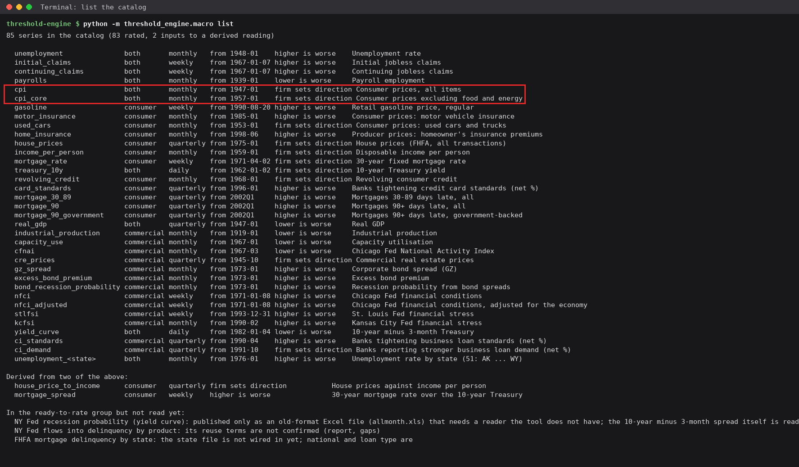
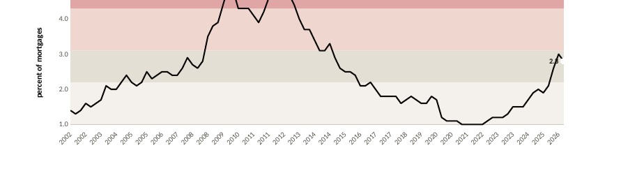

# Walkthrough defects: the economic conditions tool, 16 October 2026

One walk of the monthly refresh, done as the analyst does it: install, list, pull, rate, write the
workbook, then read every kind of tab. Done in a clean Python 3.13 environment, with LibreOffice 24.2
as the spreadsheet; there is no Excel here. The procedure it produced is
`refresh-2026-10-16/PROCEDURE-refresh-2026-10-16.pdf`.

**The denominator.** When the walk began, the tool's suite was **73 tests, all passing**. They caught
**none of the 13 findings below**. Eleven are fixed. Each fix has a test, and a deliberate break of the
fix makes that test fail (checked). The suite is now 78 tests. Two findings are open:
- **W1** needs a line in a file outside the paths this work may write.
- **W12** is a feature, proposed below.

Nothing was fixed during the walk. Each fix was made after it, and checked by walking its step again.

They are ranked by what each would cost the teams that read the workbook.

| # | Finding | Status |
|---|---|---|
| W4 | A second pull the same day replaced the first; a workbook could name data that no longer existed | Fixed |
| W6 | Series rated on their change only hid their latest value (gasoline never said $4.33) | Fixed |
| W7 | Chart labels printed the raw float, after a fix had been claimed | Fixed |
| W2, W3 | `list` said "firm sets direction" after the firm had set them, and of two series never rated | Fixed |
| W1 | The pull goes into `work/` inside the repository, which nothing ignores | **Open** |
| W12 | A what-if needs a hand-written comparison | **Open (proposal)** |
| W10 | Quarterly chart axes repeated the year | Fixed |
| W8 | A tab's "change only" note was cut off | Fixed |
| W14, W11 | Printing gave 856 pages, and the Sahm chart split across two | Fixed |
| W5 | The "History from" date ran into the unit | Fixed |
| W9 | A rating table's note said "readings" on a table of changes | Fixed |

---

## W4. A second pull the same day replaced the first

**Did:** pulled in the morning and wrote a workbook. Then pulled again the same day, as an analyst would
after a release.

**The screen said:** `pulled 85 of 85 series into work/macro-cache/2026-10-16`, both times.

**What was true:** the second pull wrote into the same folder and replaced the morning's files. The
morning's workbook says *From the pull of 2026-10-16*, and that folder no longer held what it read.
TOOL.md promised the pull "never overwrites an earlier one".

**Fix:** a pull never writes into an existing folder. The second pull of a day goes to `2026-10-16-2`,
the third to `-3`. The newest is read by default, and `-10` is newer than `-9` even though it sorts
before it as text. Tests: `test_a_second_pull_the_same_day_gets_its_own_folder`.

## W6. A series rated on its change only hid its latest value

**Did:** read the Ratings tab for the narrative.

**The screen said:** gasoline, `change only`, +41.49%, rated 4. There was no price.

**What was true:** $4.331 a gallon was in the pull. It is the figure a reader quotes first. The same
held for the other eleven series rated on their change: CPI, payrolls, GDP and the rest.

**Fix:** every row shows the series' latest value and its date, whether or not the level is rated. Test:
`test_a_series_rated_on_its_change_only_still_shows_its_latest_value`.

## W7. Chart labels printed the raw float, after a fix was claimed

**Did:** opened the gasoline tab.

**The screen said:** the latest point on the chart was labelled `41.4897092453`.

**What was true:** the earlier commit said the label had a number format. LibreOffice ignores a data
label's own format, so the claim had not been checked on the screen it was about.

**Fix:** the value behind the label is rounded at its source, to two decimal places. Test:
`test_the_latest_point_on_a_chart_is_labelled_rounded`.

## W2, W3. `list` described a state that had stopped being true

**Did:** ran `list` after the firm had answered the settings.

**The screen said:** `firm sets direction` for nine series. The same text appeared for income per
person and the 10-year Treasury.

**What was true:** the firm set those nine on 16 October; the answers are in `settings.json`. The two
inputs are never rated, so they have no direction at all. The column was also too narrow for the text,
which pushed those rows' titles out of line.

**Fix:** the nine read *the firm's settings*, and the inputs read *input, not rated*. Test:
`test_list_says_where_the_firms_directions_are_and_that_inputs_are_not_rated`.

## W1. The pull goes into the repository, and nothing ignores it (open)

**Did:** followed TOOL.md: `pull --cache work/macro-cache`.

**What was true:** 82 downloaded files and the workbook sat untracked in the checkout. They were one
`git add .` away from being committed. `pip install .` also leaves a `build/` folder there.

**Fix, not made:** add `work/` (and `build/`) to `threshold-engine/.gitignore`. That file is outside the
paths this work may write, so this is left to the firm or the session that owns threshold-engine. Until
then, the procedure's last step says to delete `work/` before committing.

## W12. A what-if needs a hand-written comparison (open: a proposal)

**Did:** asked what changes if each reading is measured against the last 30 years, not its full history.

**What was true:** the tool rates with any settings file, but has no way to set two runs side by side.
The answer took a short script: 7 of 56 national readings change rating, including the mortgage rate's
level, from 2 to 4. The threshold workbook's *What happens if* section is the model.

**Proposal:** `rate --compare OTHER-SETTINGS.json` would print, and write to the workbook, each reading
whose rating differs, old and new. The firm decides whether it is wanted.

## W10. Quarterly axes repeated the year

**The screen said:** `2002 2002 2003 2003 …` along the axis of every quarterly chart. LibreOffice ignores
the label spacing the workbook sets, and the format showed the year only.

**Fix:** quarterly axes are labelled year and month (`2002-04`).

## W8. The "change only" note was cut off

**The screen said:** *Change only: its level climbs over the decades with prices and the economy, so its
place in its*, and the rest was cut off by the row height.

**Fix:** the note sits in the tall row with the sentences.

## W14, W11. Printing

**The screen said:** the workbook printed as 856 pages, about 800 of them data columns. The Sahm chart's
title fell on one page and its plot on the next.

**Fix:**
- Each series tab prints its ratings, charts and facts; its history stays on screen.
- The Sahm chart starts a page.
- The workbook now prints as 104 pages.

Test: `test_a_series_tab_prints_its_ratings_and_charts_not_its_whole_history`.

## W5. "History from" ran into the unit

**The screen said:** `1940-01 thousands of jobs`: a right-aligned date against left-aligned text in the
next column.

**Fix:** the unit sits beside the value it belongs to (`159,044 thousands of jobs`), and the date is
centred.

## W9. "Readings" on a table of changes

**Fix:** one sentence serves both kinds of table: *the least extreme reading (or change) in this history
that took the rating; every one further in the direction of stress took that rating or higher.*

## Kept as it is

- **The refusal names settings by their keys** (`cutoffs`, `ci_demand`). Those are the words in the
  file the analyst is editing, so they read.

## Not this tool's

- `pip install .` leaves `build/` in the checkout (see W1).
