> **Since 22 Oct 2026 the tool rates nothing and the command is `read`, not `rate`** (see `docs/macro/TOOL.md`). This procedure is the walk of 16 Oct 2026, kept as it was.

# Refresh the economic conditions workbook

The monthly job: download the public data, rate it with the firm's settings, write the workbook and read
it for the narrative. Walked end to end on 16 October 2026, twice: once to find what was wrong, and once
after the fixes, which is the run pictured here. About five minutes, most of it the download.

**You need:** this repository checked out, Python 3.10 or later, and internet access to FRED, the
Bureau of Labor Statistics, the Federal Reserve Board and FHFA. No key or password. A spreadsheet
program: the pictures are LibreOffice; Excel shows the same workbook.

**The rule that does not bend:** only public data goes in. Nothing from the bank's own books.

## Part 1: the terminal

### 1. Install the tool

In the `threshold-engine` folder, run:

    python -m pip install .

**A correct screen** ends `Successfully installed threshold-engine-0.11.0` (the number may be higher).

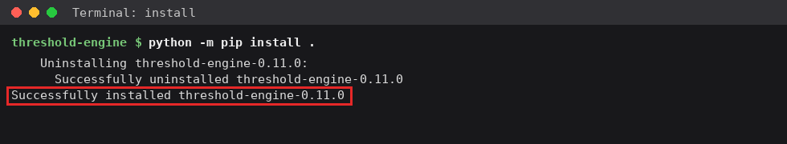

### 2. See what it reads

    python -m threshold_engine.macro list

**A correct screen** lists 85 series, then two readings made from two series, then three it does not
read yet and why. Nine series say *the firm's settings* where the direction of stress would be: the
firm chose those on 16 October 2026, in `docs/macro/settings.json`. Two say *input, not rated*.

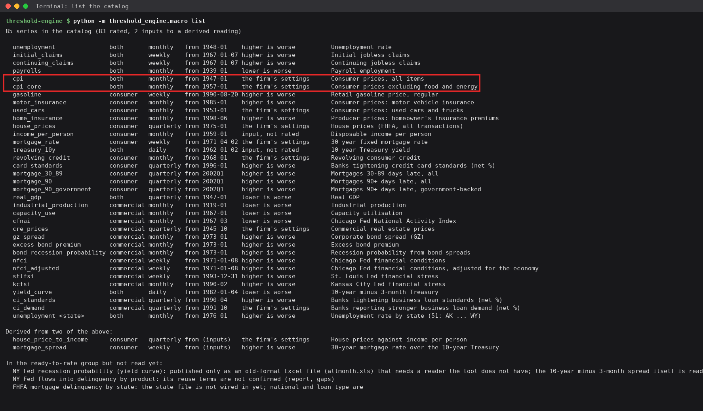

### 3. Download the data

    python -m threshold_engine.macro pull --cache work/macro-cache

It takes about a minute. **A correct screen** says `pulled 85 of 85 series into
work/macro-cache/` and today's date. If a series fails, it says `FAILED`, the series and why, pulls the
rest, and the command ends with an error. Rate anyway and the failed series is listed as not rated.

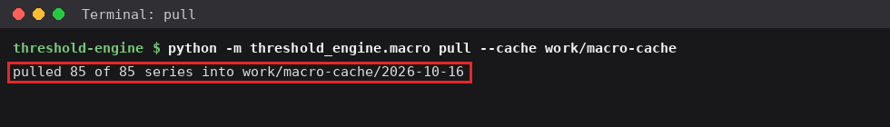

Every download is kept in its own folder. Pull again the same day, after a release, and the new one goes
to today's date with `-2` after it; the earlier folder is untouched, so a workbook made from it can still
be traced to what it read.

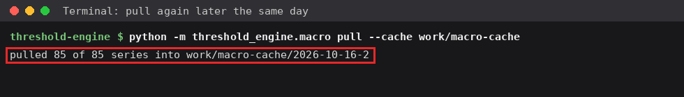

### 4. Rate

    python -m threshold_engine.macro rate --cache work/macro-cache --settings docs/macro/settings.json

**A correct screen** opens with one line naming the pull, the history, the change horizon and the
cut-offs, then every rating, highest first, each with the sentence behind it. The last line is the Sahm
reading, shown and never rated.

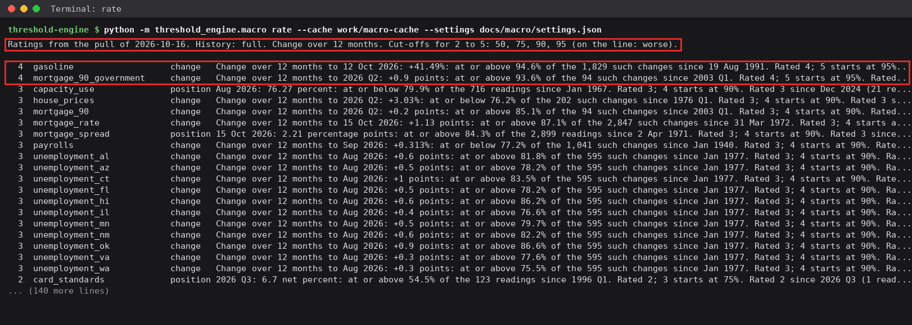

### 5. Write the workbook

Run the same command with `--workbook` and a file name:

    python -m threshold_engine.macro rate --cache work/macro-cache --settings docs/macro/settings.json --workbook work/economic-conditions.xlsx

**A correct screen** ends `wrote work/economic-conditions.xlsx` after about ten seconds.

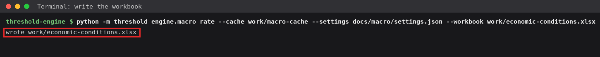

## Part 2: the workbook

### 6. Read the Ratings tab

Open the workbook; it opens on **Ratings**. At the top, the count of national readings at each rating:
on 16 October 2026, none at 5 High, two at 4, six at 3. Below, every series under its topic (jobs;
prices and insurance; housing and household credit; business and the economy; markets and financial
conditions), the highest-rated first, with its latest value, both ratings and the sentence that stands
out.

**Check:** the counts add up to the number of national readings (56). Find each 4 and 5 under its topic.

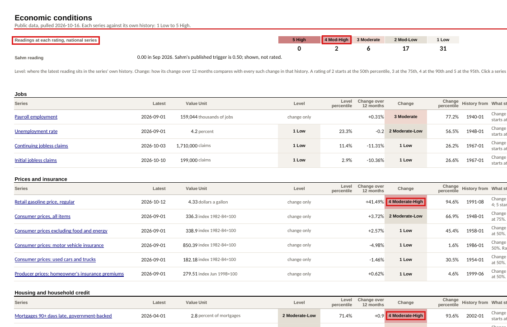

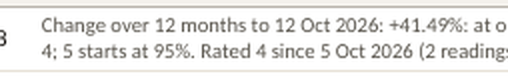

### 7. Open a series: gasoline

Click a series' name; it opens its tab. Each tab gives both ratings with what drove them, then
**Where each rating starts**, in the series' own units, and how many readings in its history took each
rating. Under that, its history drawn over the five rating bands.

**Check:** the latest value sits between where its rating starts and where the next one starts.
Gasoline's change over a year, +41.49%, is at or past 34.43% (where 4 starts) and short of 42.4% (where 5
starts), so it is a 4.

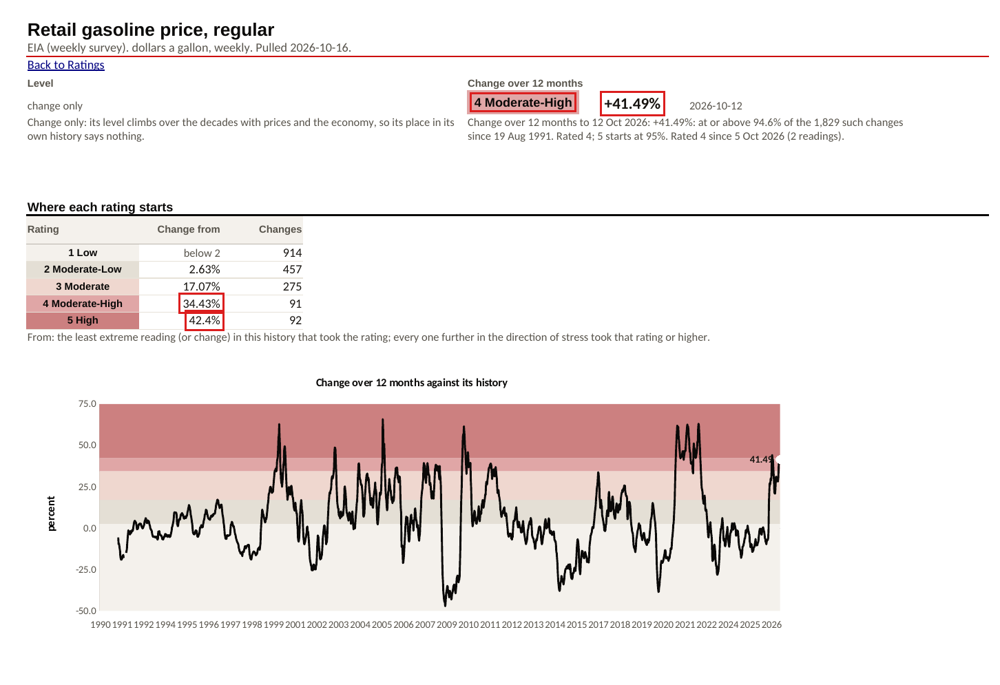

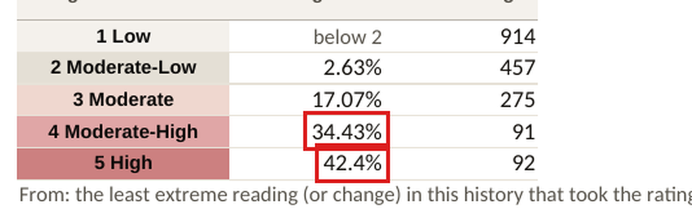

### 8. The other 4: government-backed mortgages 90+ days late

The level, 2.8% of mortgages, is a 2 (2 starts at 2.2, 3 at 3.1). The change over a year, +0.9 points,
is a 4 (4 starts at 0.6, 5 at 1.0). A series can be calm on one reading and stretched on the other; the
Ratings tab shows both side by side for that reason.

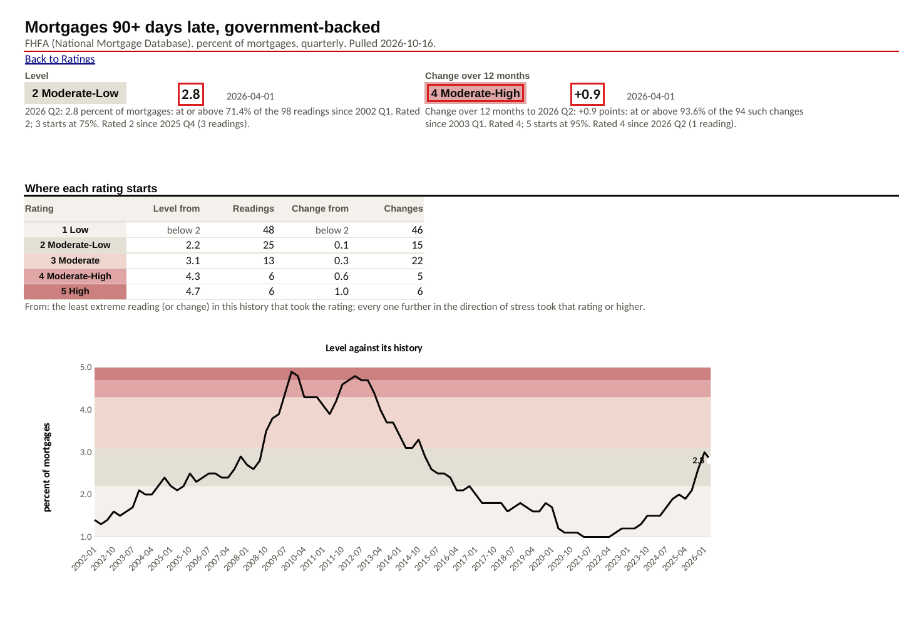

### 9. Unemployment

Level 4.2%, rated 1; change over a year −0.2 points, rated 2. The rating table shows the rate would
need to reach 5.4% to rate 2 on its level, and 9.0% to rate 5.

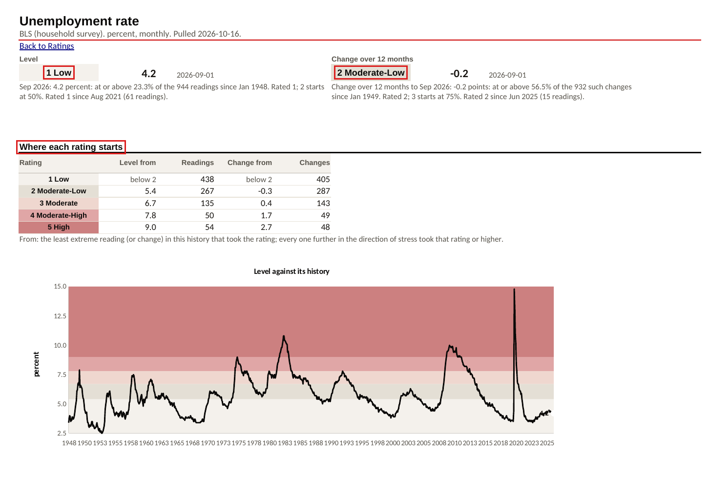

### 10. The Sahm reading

Further down the unemployment tab: the Sahm reading over its history, with Sahm's published trigger,
0.50, as a dashed line. On 16 October 2026 it is 0.00. It is shown beside the ratings and never used to
make them.

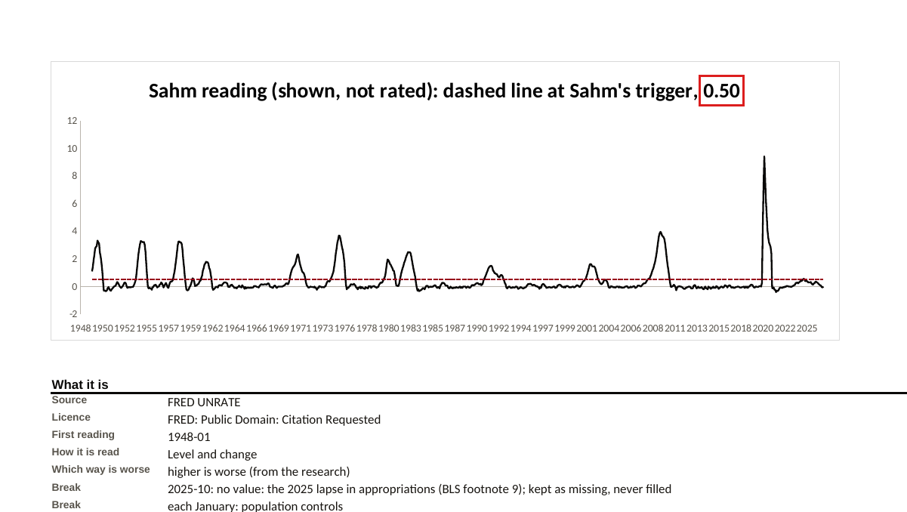

### 11. States

**States** rates each state's unemployment rate the same way, worst first. State data runs a month
behind the national rate (August against September on 16 October 2026).

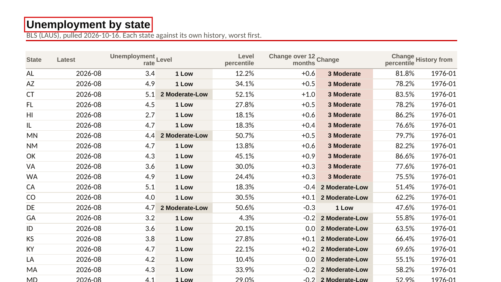

### 12. Look up a word

**Glossary** explains every term in the workbook and how it is worked out, from the settings the run
used: the cut-offs it names are the ones in force.

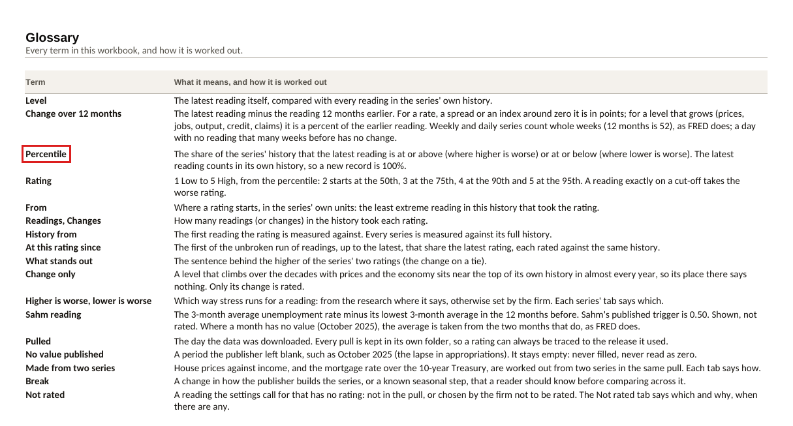

### 13. Check what went in

**Run** says when the workbook was built, from which pull, and every answer in the firm's settings.

**Check:** *From the pull of* is the folder you rated.

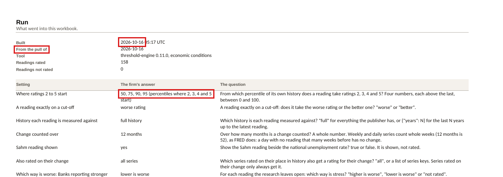

### 14. Check a file

**Sources** lists every file the pull fetched: its address, licence, when it was fetched and its SHA-256
fingerprint. The fingerprint is the same as in the pull folder's `manifest.json`; a different one means
the workbook was made from different data.

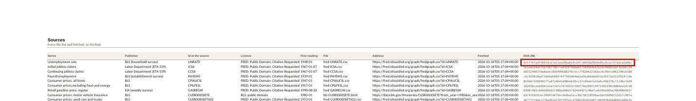

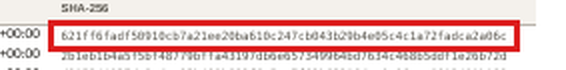

## Part 3: what if, and what refuses

### 15. Try another setting without changing the firm's

Copy `docs/macro/settings.json` to `work/`, change an answer in the copy (here the history, from
`"full"` to `{"years": 30}`), and rate with `--settings` pointing at the copy. Only answers are read.

Against the last 30 years rather than full history, 7 of the 56 national readings change rating; the
mortgage rate's level goes from 2 to 4. The window matters, as the research warned. (Comparing the two
runs took a short script: see the walk's defects, W12.)

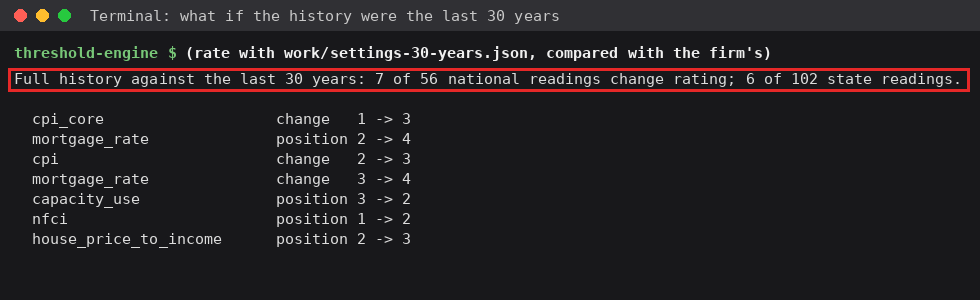

### 16. A settings file not yet filled in

`settings-template` writes the questions with every answer empty. Rate with it and the tool refuses,
naming every gap at once, and rates nothing.

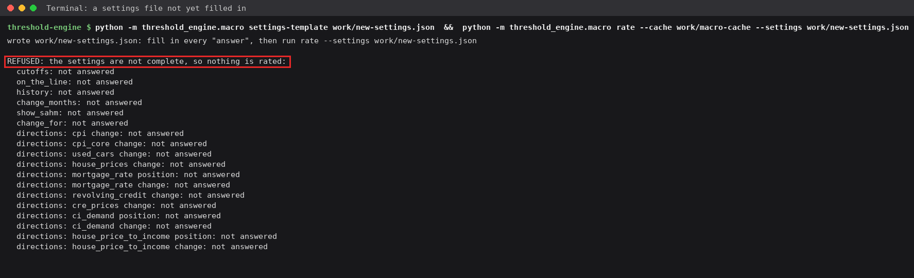

## When you are done

The pull and the workbook are in `work/` inside the repository. Nothing tells git to leave `work/` alone
yet (defect W1), so delete it or move it before committing anything.

## A wrong screen

- `pulled 84 of 85` or a `FAILED` line: a publisher did not answer. Pull again later; the earlier folder
  is kept either way.
- `REFUSED:` from `rate`: the settings file is missing an answer. The message names each one.
- A Ratings row with no rating: open **Not rated**, which says why.
- A chart line that drops to zero: it should never happen. A month with no value is an empty cell and a
  gap in the line. Report it.
