# Procedure: a credit file review, from tool to released record

*Walked through the screens on 2 November 2026. Synthetic people and data; the limit and the method are fictional demonstrations.*
*Rendered copy with every screenshot embedded: `walkthrough/credit-review-2026-11-02/PROCEDURE-credit-review-2026-11-02.pdf`.*

**The route:** Tools (propose · approve) → Settings (confirm limit) → Workpaper (details · facilities · questions) → Analysis (inputs · result · exception) → Check (submit) → Review (point · acknowledge) → Answer (preparer replies) → Approve (clear · approve) → Release (files fingerprinted)

## Set up the tool

### 1. Sign in
*Anyone*

**Do.** Open the app (http://127.0.0.1:5077). Choose your name on “Who is working?”.

**A correct screen.** A list of five people, each with what they can do. Choosing a name is not a password check; it is how the record knows who did what.

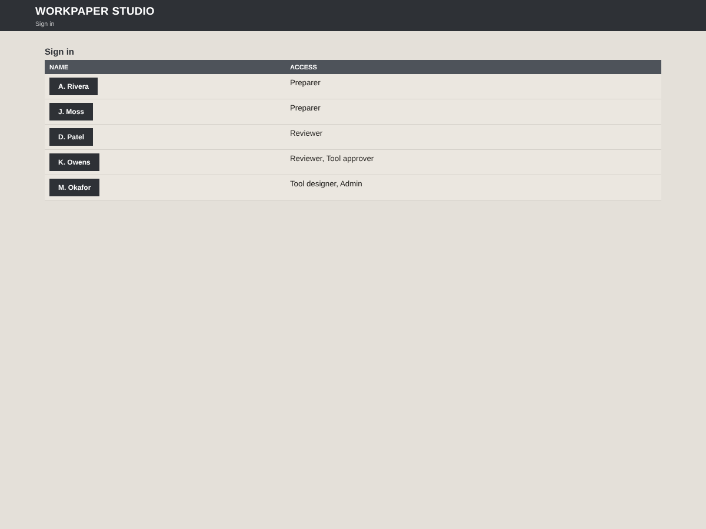

### 2. Propose the tool for publishing
*Designer (M. Okafor)*

**Do.** Go to **Tools**. On the Credit file review row, click **Propose for publishing**.

**A correct screen.** The row's state changes to “Proposed by M. Okafor, waiting for an approver”. You will not see an Approve button: nobody approves their own proposal.

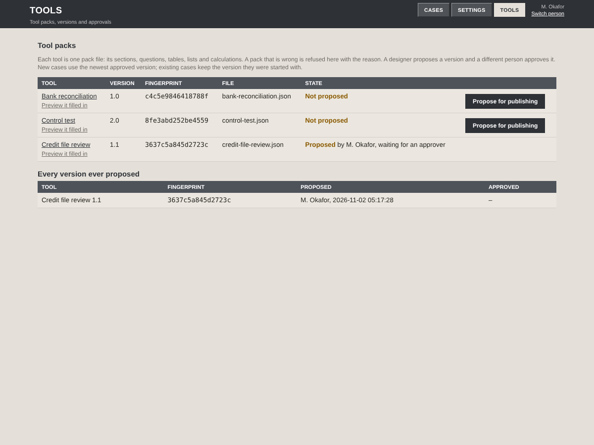

### 3. Read the tool and approve it
*Approver (K. Owens)*

**Do.** Sign in as the approver. On **Tools**, click the tool's name to read its outline, and **Preview it filled in** to see it working on the pack's own example. Then go back and click **Approve**.

**A correct screen.** The preview says nothing in it is saved. After approval the state reads “Published: proposed by M. Okafor, approved by K. Owens”. New cases now use this version; the fingerprint identifies it exactly.

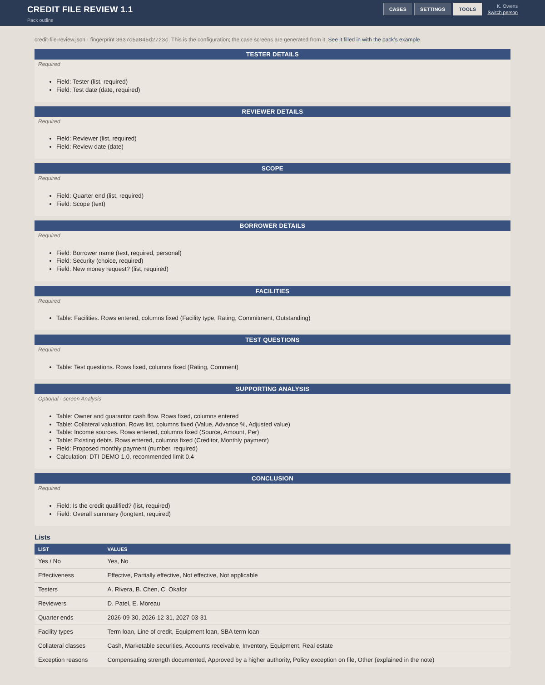
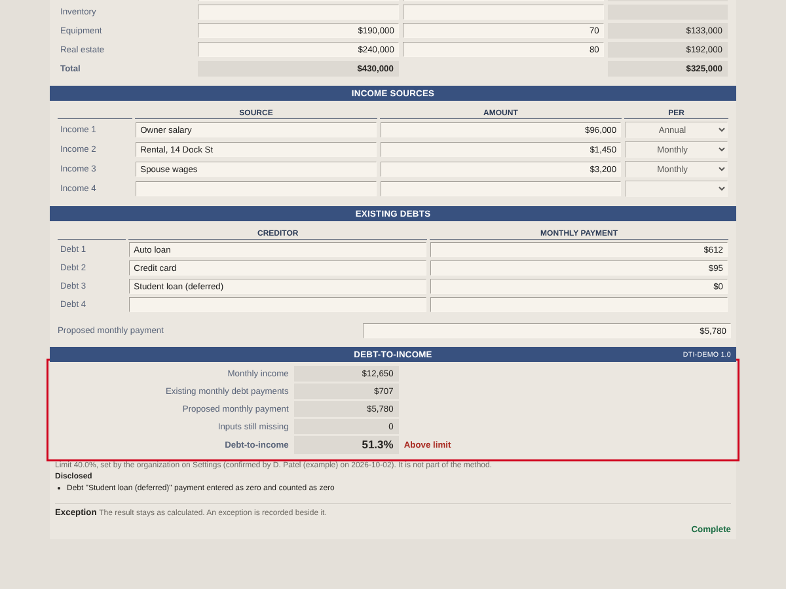

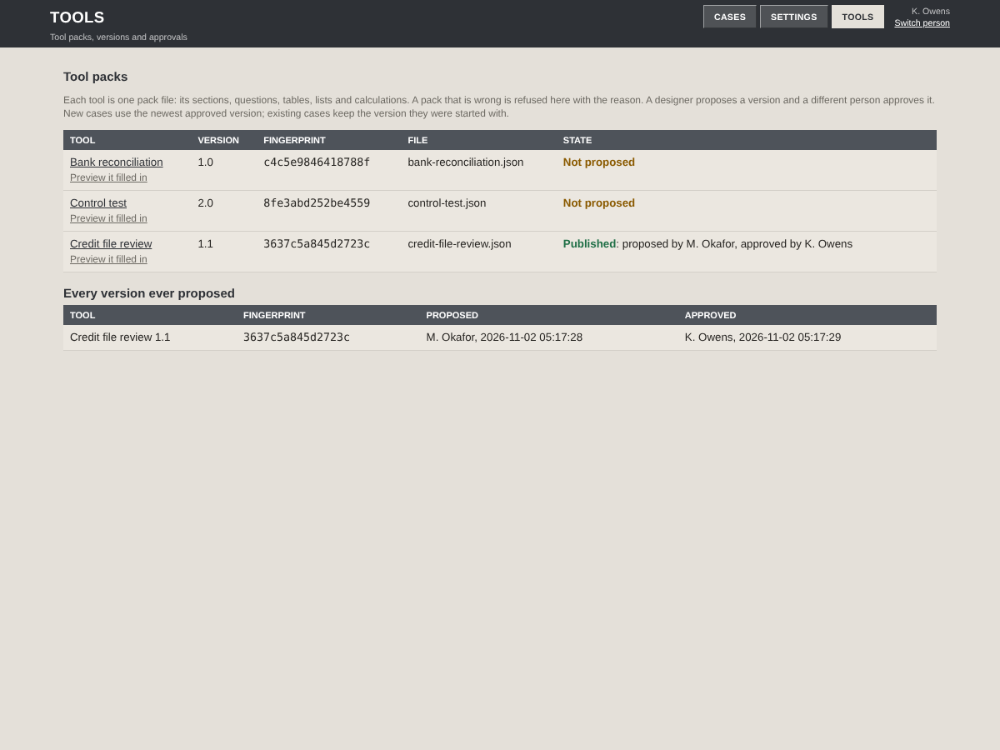

### 4. Confirm the organization's limit
*Admin (M. Okafor)*

**Do.** Go to **Settings**. The debt-to-income limit is *Not confirmed*. Type your organization's limit (40 for this demonstration) and click **Confirm**.

**A correct screen.** State reads “Confirmed by M. Okafor” with the date, and a new version appears under Versions. Until a limit is confirmed, no result is tested against it. The 40% is fictional.

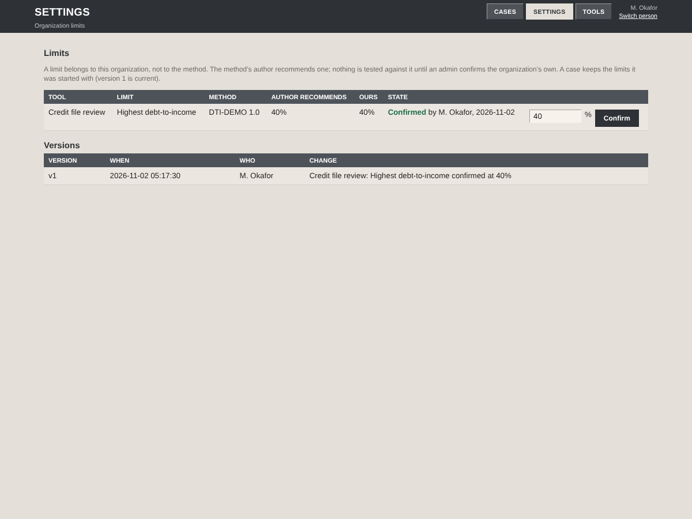

## Prepare the case

### 5. Start a case
*Preparer (A. Rivera)*

**Do.** Sign in as the preparer. On **Cases**, click **New credit file review**.

**A correct screen.** A new case opens (CFR-0001). Every required box is amber. The strip says Ready for review: No, Still missing: 19.

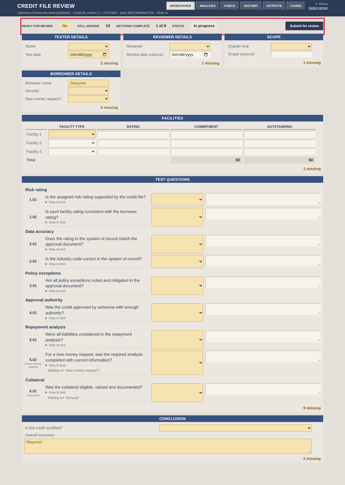

### 6. Fill the detail panels
*Preparer*

**Do.** Fill Tester, Test date, Reviewer, Quarter end, Scope, Borrower name, Security and New money request. Each entry saves when you leave the box.

**A correct screen.** Each panel's footer turns to a green Complete. “Saved” appears at the foot of the page. Still missing drops to 12. Tab moves on as you would expect; each box's small N/A button is one Tab stop of its own.

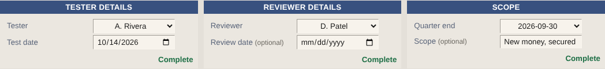

### 7. Enter the facilities
*Preparer*

**Do.** Enter each facility on its own row: type, rating, commitment, outstanding. A new empty row appears as you use the last one.

**A correct screen.** A row that is started but incomplete shows its missing box in amber, the section says “1 missing”, and the total under that column reads **Not calculated** until the gap is filled. When every row is complete the footer reads Complete.

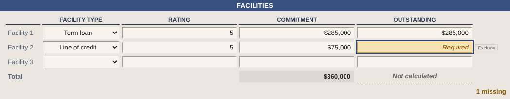
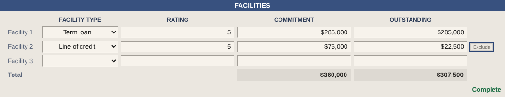

### 8. Answer the test questions
*Preparer*

**Do.** Rate each question from the list. Open *How to test* under a question to read its steps. Write a comment where you have one.

**A correct screen.** Ratings show in green, amber or red. A rating of Partially or Not effective makes the comment box amber and required until you write one. Questions that depend on an answer (for example 5.02, only for new money) say so under the number.

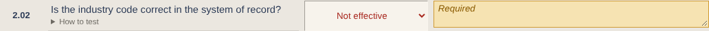

### 9. Complete the supporting analysis
*Preparer*

**Do.** Click **Analysis** in the band. Enter income sources, existing debts and the proposed monthly payment. The cash flow and collateral tables are optional.

**A correct screen.** While any input is missing, debt-to-income reads **Not calculated**, never 0. The reason is listed under “Why there is no result”. When every input is in, the result shows (51.3% here) with its verdict against the confirmed limit. A zero payment is disclosed, not hidden.

### 10. Record an exception for a result above the limit
*Preparer*

**Do.** Under the result, choose a reason, explain it, and click **Record exception**.

**A correct screen.** The exception is listed beside the result, “Waiting for the reviewer to acknowledge it”. The result itself does not change.

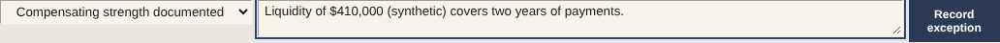
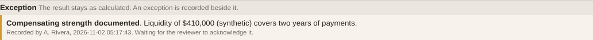

### 11. Submit for review
*Preparer*

**Do.** Click **Submit for review**. If anything is missing you land on the release check with a message; click **Go to it** on each line, fill it, and submit again.

**A correct screen.** When it goes through, the Status chip reads **In review** and your boxes lock. Every line on the release check is OK except the exception (waiting for the reviewer) and the approval.

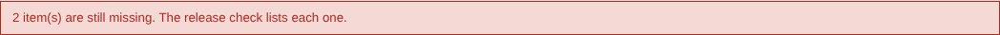
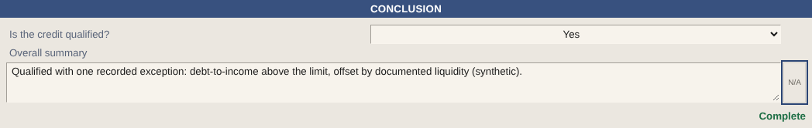
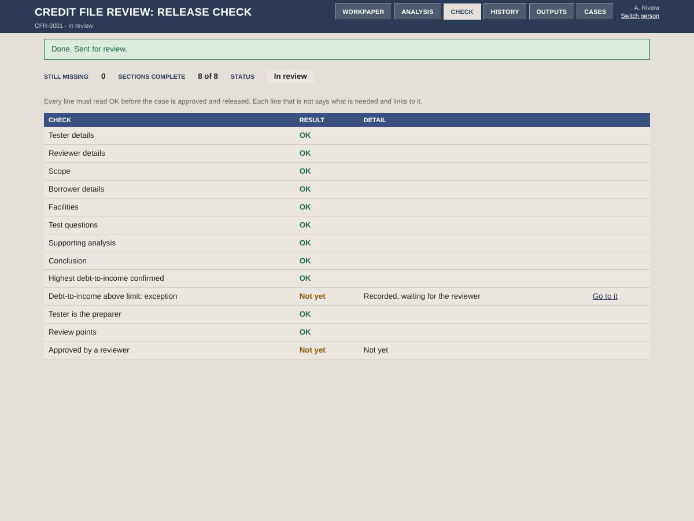

## Review

### 12. Open the case and raise a point
*Reviewer (D. Patel)*

**Do.** Sign in as the reviewer. The case is under **Waiting for your review**; open it. Under the section concerned, write the point and click **Raise point**.

**A correct screen.** Your boxes are read-only: a reviewer never changes the preparer's entries. The point shows as Open with your name and the time.

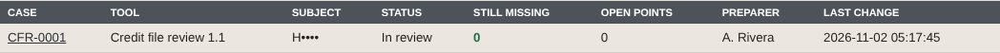

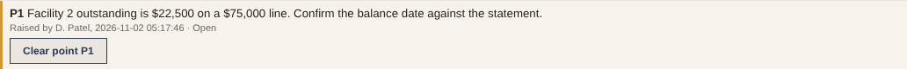

### 13. Acknowledge the exception
*Reviewer*

**Do.** Clicking **Approve** now is refused, and the message names what is open. Go to **Analysis** and click **Acknowledge** on the exception.

**A correct screen.** The exception reads “Acknowledged by D. Patel” with the time.

### 14. Answer the point
*Preparer*

**Do.** Sign in as the preparer. Your Cases list shows “1 (waiting for your answer)” under Open points. Open the case: a banner at the top links to the point. Write your answer under it and click **Answer**.

**A correct screen.** Your answer appears under the point with your name and the time.

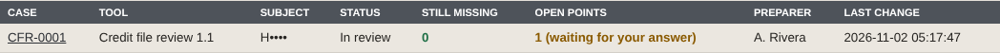
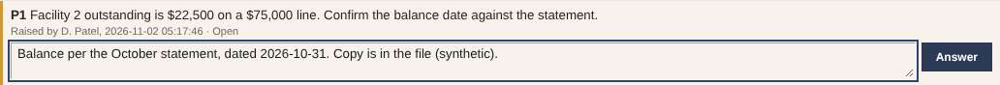

## Approve and release

### 15. Clear the point, approve, release
*Reviewer*

**Do.** Sign in as the reviewer. Click **Clear point P1**, then **Approve**, then **Release**.

**A correct screen.** The point reads Cleared. Each action confirms itself in a green banner. The status goes to Approved, then Released, and Outputs lists the released files, each with its SHA-256 fingerprint: the data feed (JSON and CSV) and the workbook. The workbook has an Exceptions and review sheet; the borrower's name is masked in every released file.

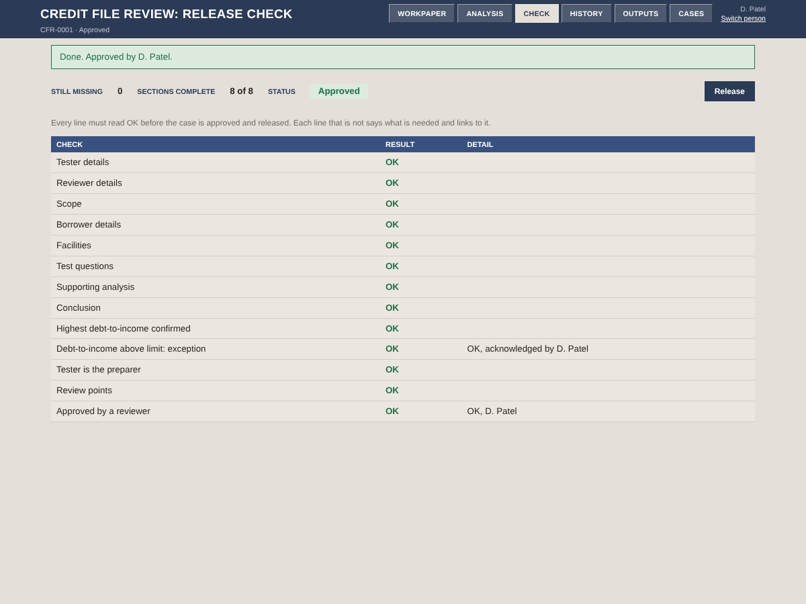
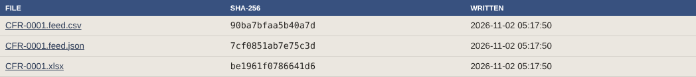

### 16. Read the record
*Anyone*

**Do.** Click **History**.

**A correct screen.** Every entry and every action, newest first, with who and when. Nothing in it can be changed or removed; the case on screen is rebuilt from it.

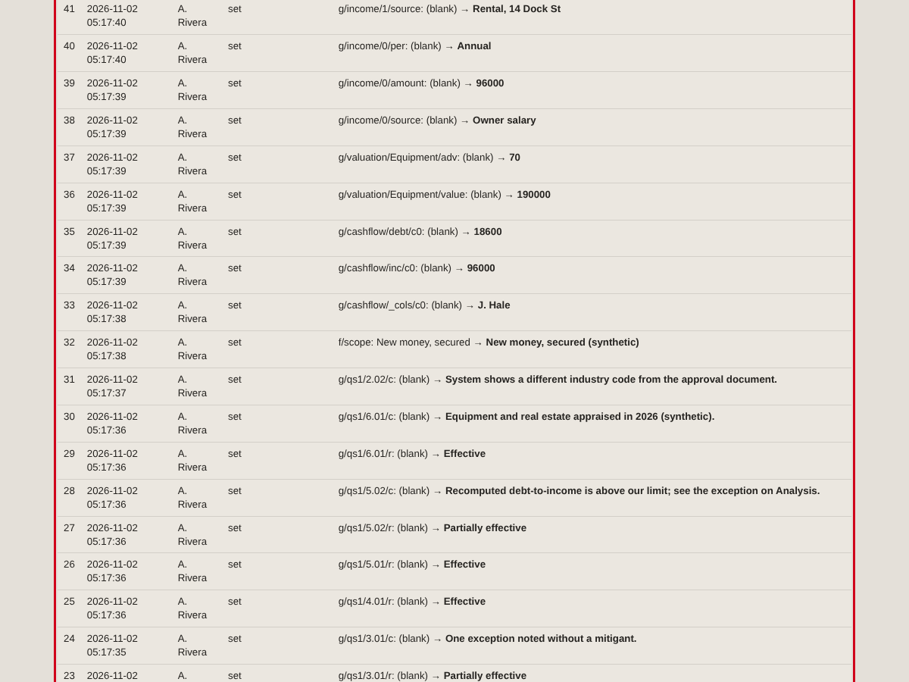
