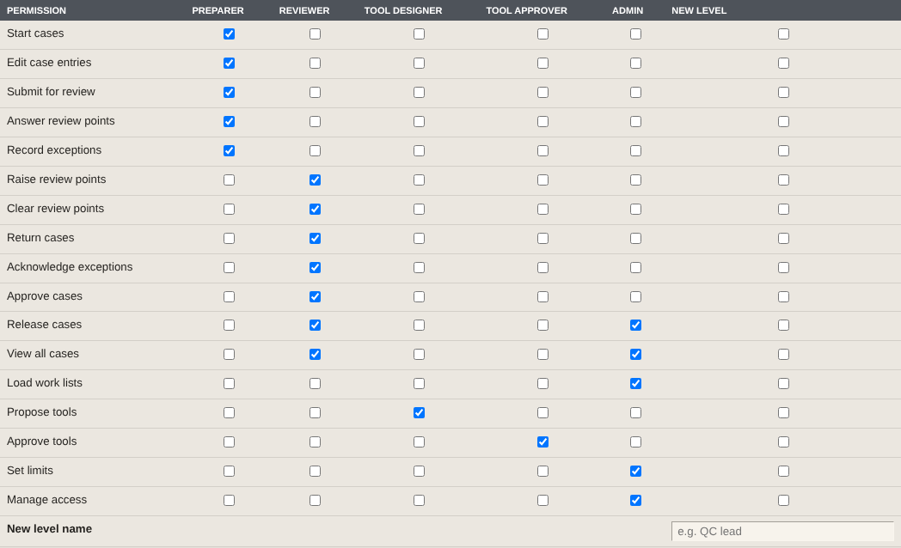
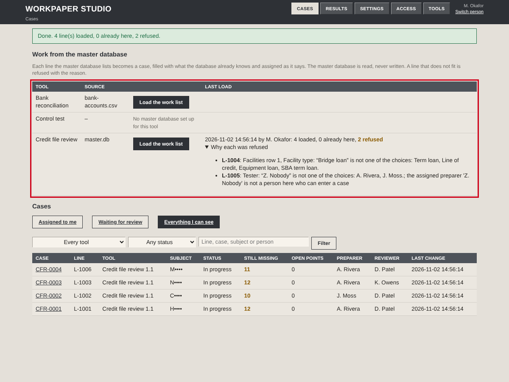
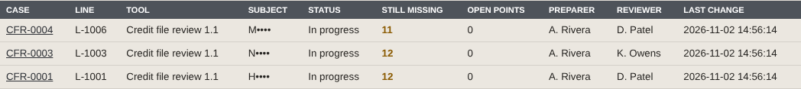
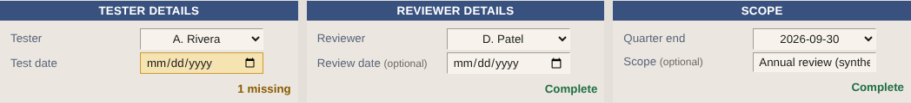
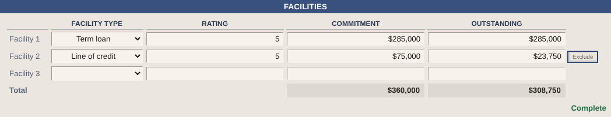
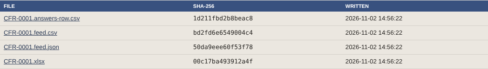
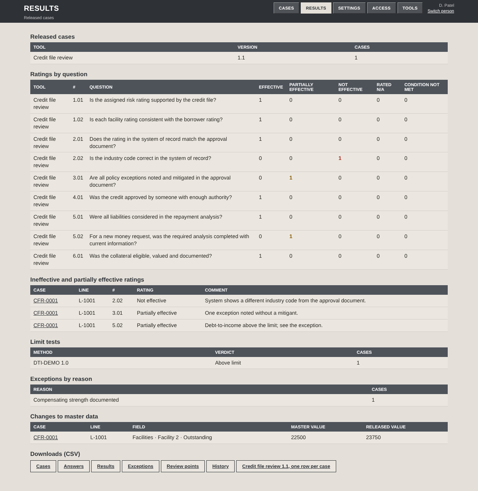
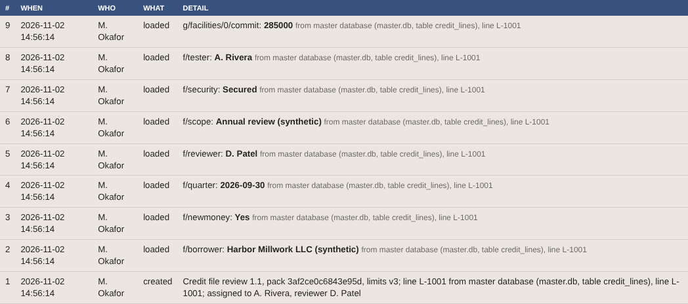

# Workpaper Studio: Work List and Results Procedure

| | |
|---|---|
| Document | Procedure for loading the work list from the master database, completing assigned cases, and reviewing results |
| Effective date | [CONFIRM: effective date] |
| Owner | [CONFIRM: procedure owner] |
| Applies to | Credit file review, version 1.1 |
| Data | Synthetic master database. Names, borrowers and limits are fictional. |

## Purpose

This procedure explains how cases are created from the master database, how a preparer completes an assigned case, and how released results are reviewed across cases.

## Scope

It covers access levels, loading the work list, working an assigned case, correcting master data, and the Results screen. Completing, reviewing and releasing a case is covered in the Credit File Review Procedure.

## Before you start

| System | Access needed |
|---|---|
| Workpaper Studio | A name set up on the Access screen |
| Admin | Manage access and Load work lists |
| Preparer | Edit case entries |
| Reviewer | Approve cases and Release cases |
| Master database | Configured for the tool by the installation |

## Route

Access → Load → Assigned to me → Case → Release → Results

## Steps

### A. Review access levels
*Admin*

- Select **Access**.
- Review the permissions for each level and the levels each person holds.
- Make any change, enter a change note, and select **Save**.

**Expected result.** The change is saved as a new version under Access history.

**Note:** The fixed controls apply whatever is selected: a preparer cannot review or approve a case they prepared or entered, a tool cannot be approved by the person who proposed it, and the case history cannot be changed.

(i) 

### B. Load the work list
*Admin*

- On **Cases**, under Work list, select **Load work list** on the tool's row.
- Open **Refused lines** to review each refused line.

**Expected result.** The banner reads *Work list loaded* with the number of new, existing and refused lines. Each refused line shows its reason.

**Note:** A line is refused when a value does not match the tool, such as a facility type that is not on its list, or when the assigned preparer is not set up in Access. Correct it in the master database and load again.

(i) 
(ii) 

### C. Select an assigned case
*Preparer*

- On **Cases**, select **Assigned to me**.
- Filter by tool or status, or search, as needed.

**Expected result.** The cases assigned to you, each with its master database line number.

(i) 

### D. Verify the pre-filled values
*Preparer*

- Open the case.
- Verify the values loaded from the master database against the file.

**Expected result.** Tester, reviewer, quarter, borrower, security and the facilities are already entered. The status strip counts only what is left.

(i) 

### E. Correct master data where it is wrong
*Preparer*

- Enter the correct value over the loaded value.

**Expected result.** The new value is kept. The case history shows the loaded value and the change, and Results lists the case under Changes to master data.

(i) 

### F. Complete, review and release the case
*Preparer and reviewer*

- Follow steps F to O of the Credit File Review Procedure.

**Expected result.** Outputs lists four released files: the data feed (JSON and CSV), the workbook, and the answers file with every answer in one row.

(i) 

### G. Review results across cases
*Anyone with access*

- Select **Results**.
- Use **Downloads (CSV)** to take any table for further analysis.

**Expected result.** Results shows ratings by question, each ineffective or partially effective rating with its comment, limit tests, exceptions by reason, and changes to master data, for every released case.

**Note:** Results includes released cases only. Personal fields, such as the borrower name, are masked.

(i) 

### H. Trace a value to its source
*Anyone with access to the case*

- Open the case and select **History**.

**Expected result.** The first entries, at the foot of the list, are the values loaded from the master database, each with its line number. Every change after that shows who made it, when, and the old and new value.

(i) 

## Best practices

- Correct master data in the case, so the change is recorded, rather than editing the master database mid-review.
- Review refused lines after every load; a refused line is not tested until it is corrected and loaded again.
